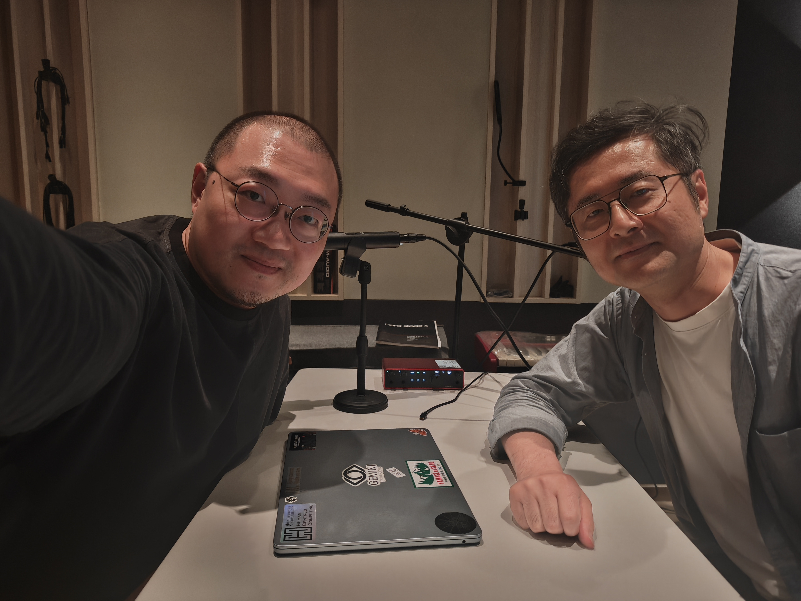

<h1>与奇人相遇｜Meetings with Remarkable Humans</h1>

<h2>Listen</h2>

<audio controls preload="metadata" style="width: 100%;">
  <source src="/podcast/EP-04_Zhao-Shengdong.mp3" type="audio/mpeg">
  Your browser does not support the audio element.
</audio>

  <a href="/podcast/EP-04_Zhao-Shengdong.mp3">Download audio file</a>

  

赵盛东老师是香港城市大学创意媒体学院的教授，领导着 Synteraction lab。赵老师是在中文人机交互研究领域大家都非常熟悉的一名学者。他博士毕业于多伦多大学，近些年先后在新加坡国立大学和香港城市大学任教，主要研究领域包括 Heads-up Computing（合姿计算）以及用户认知行为建模。

赵老师也是给我很多支持和指点的前辈，之前我在香港科技大学（广州）举办的人机交互理论研讨会也是有幸请到了赵老师加入。每次我们在国内外参加会议也都会在一起聊天。这次是赵老师来广州参加 ICXR 和 ChinaVR 的会议作主题报告，顺路也来了我们科广 CMA 做了一个对他们组近期发的一篇关于眼动和阅读理解之间关系的建模的 Nature Human Behaviour 论文的分享，有兴趣的朋友可以去了解这项研究。

同时赵老师近期也写了一本书 — 《人机交互研究漫游指南》 — 一本对人机交互领域的学生和学者都很有学习和参考价值的书，也欢迎大家去赵老师的 Synteraction Lab 公众号去了解。这次短暂的一个小时中，我们进行了一些关于人机交互研究的闲谈，赵老师也分享了他对即将和正在到来的 AI 加速时代的思考。

以下是结尾我分享的引用：

> “面对数字加速，我们今天应当如何看待知识的生产？我们是在怀念启蒙运动及其人文主义、怀念对人类主体自主性的信仰吗？未必。但拒绝某种关于启蒙的刻板印象，并不等于认同“黑暗启蒙”（Dark Enlightenment）。 后疫情世界接连不断的动荡，似乎宣告了1990年代那个梦想的终结，也要求我们打开新的思想视野。如果未来的知识生产真的交给了人工智能，那将是一种与我们无关的知识。这样的机器接管会是一个理性的演化过程，我们不应试图与之竞争，正如我们不应试图跑赢一辆疾驰的汽车。然而，在这一切发生之后，如果我们还要谈论知识，那将是一种关于生命的知识，关于如何好好生活、如何共同好好生活。归根到底，活着的对立面不是死亡，而是意义的丧失，是功利目的之外那个更高目的的丧失。”
>
> — 许煜：《自动知识限度内的大学》

> “机械要重新找到它真正的使命，提供与其力量相称的服务，只有一个条件，那就是被它压得更深地俯向大地的人类，能够借助它重新挺立，仰望天空。 ”
>
> — 亨利·柏格森：《道德与宗教的两个来源》

背景音乐：Cornelius Cardew & The Scratch Orchestra - The Great Learning (Paragraph 1)

<h2>小宇宙</h2>

  

